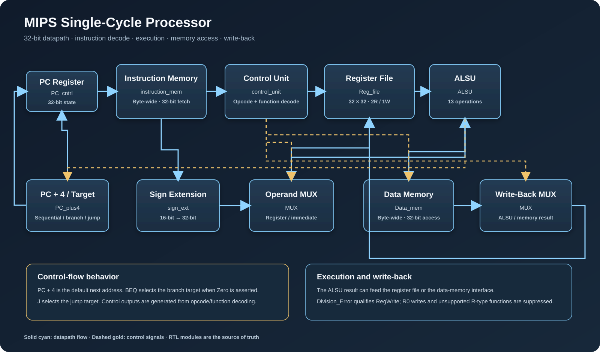
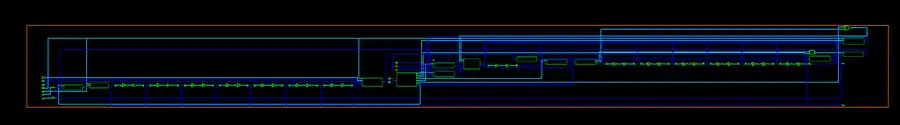

# MIPS Single-Cycle Processor

A 32-bit **MIPS-like single-cycle processor** implemented in SystemVerilog. The design integrates a custom 13-operation arithmetic/logic unit (ALSU), a 32 × 32-bit register file, byte-organized instruction and data memories, branch/jump control flow, and a self-checking QuestaSim verification environment. The ASIC synthesis flow targets the TSMC 130 nm standard-cell library using Synopsys Design Compiler.

> **ISA scope:** This project implements the instruction subset documented below. It is not a complete implementation of the standard MIPS ISA.

## Project overview

| Block | Implementation |
|---|---|
| Datapath | 32-bit single-cycle datapath |
| Control | Main opcode decoder and R-type function decoder |
| ALSU | 13 arithmetic, logic, multiply/divide, and comparison operations |
| Register file | 32 × 32-bit; two asynchronous read ports and one synchronous write port |
| Instruction memory | Byte-wide storage with a 32-bit instruction fetch interface |
| Data memory | Byte-wide storage with a 32-bit read/write interface |
| Control flow | PC+4, BEQ branch, and J jump |
| Exception behavior | Divide-by-zero detection suppresses register write-back |
| Verification | 41-instruction program, 36 self-checking checks |
| ASIC flow | Design Compiler synthesis using TSMC 130 nm standard cells |

## RTL architecture

The architecture is arranged in two views: the PC/next-address path and the instruction decode, execution, memory, and write-back datapath. Solid lines show instruction/data and PC paths. The RTL source defines the exact ports, signal names, and behavior.

## Synthesized Design Vision schematic

This is the supplied Design Vision schematic-window capture for MIPI_Single_cyc_top_IMEM_DEPTH256_DMEM_DEPTH64. It is a zoomed-out synthesized schematic view, not a placement/routing layout or physical-design sign-off image.

## Datapath operation

1. **Program counter:** PC_cntrl stores the 32-bit PC with an active-low asynchronous reset. PC_plus4 calculates PC+4, the branch target, and the jump target.
2. **Instruction fetch:** instruction_mem stores 8-bit entries and assembles four consecutive bytes into a 32-bit instruction.
3. **Decode and register read:** control_unit decodes the opcode and R-type function code. Reg_file supplies two asynchronous operands and accepts one clocked write.
4. **Operand selection:** sign_ext extends the 16-bit immediate. MUX selects the second ALSU operand.
5. **Execute:** ALSU performs the selected arithmetic, logic, multiply/divide, or comparison operation. Its Zero output participates in BEQ control.
6. **Memory access:** Data_mem provides byte-wide storage with a 32-bit read/write interface. RD2 is the store-data input.
7. **Write-back / next PC:** the result MUX selects ALU or memory data for register write-back. The PC path selects PC+4, the branch target, or the jump target.

### Divide-by-zero behavior

When DIV is selected and the divisor is zero, ALSU asserts Division_Error and returns a zero result. The top level qualifies register write-back:

~~~systemverilog
assign RegWrite_final = RegWrite & ~Division_Error;
~~~

This is a combinational indication for the current instruction, not a sticky status register.

## Supported instruction subset

### R-type functions

| Operation | Funct[5:0] | ALSU control |
|---|---:|---:|
| ADD | 100000 | 0000 |
| SUB | 100010 | 0001 |
| MUL | 011000 | 0010 |
| DIV | 011010 | 0011 |
| AND | 100100 | 0100 |
| OR | 100101 | 0101 |
| NAND | 100110 | 0110 |
| NOR | 100111 | 0111 |
| XOR | 100001 | 1000 |
| XNOR | 100011 | 1001 |
| EQ | 101000 | 1010 |
| GT | 101010 | 1011 |
| LT | 101011 | 1100 |

### Other instructions

| Instruction | Opcode | Behavior |
|---|---:|---|
| BEQ | 000100 | Branch if the operands compare equal |
| ADDI | 001000 | Add a sign-extended immediate |
| J | 000010 | Jump to the assembled target address |
| LW | 100011 | Load a 32-bit word from data memory |
| SW | 101011 | Store a 32-bit word to data memory |

Unsupported R-type function codes do not enable register write-back. Writes to register zero are also suppressed.

## RTL source files

| File | Module | Responsibility |
|---|---|---|
| MIPI_Single_cyc_top.sv | MIPI_Single_cyc_top | Top-level integration and datapath connectivity |
| PC_cntrl.sv | PC_cntrl | Program-counter register |
| PC_plus4.sv | PC_plus4 | Sequential, branch, and jump address calculations |
| instruction_mem.sv | instruction_mem | Byte-wide instruction storage and word fetch |
| control_unit.sv | control_unit | Main decode, supported-function check, ALSU control |
| Reg_file.sv | Reg_file | 32 × 32-bit register file |
| sign_extend.sv | sign_ext | 16-to-32-bit immediate extension |
| MUX.sv | MUX | Parameterized datapath multiplexers |
| ALSU.sv | ALSU | 13 arithmetic/logic/comparison operations |
| Data_mem.sv | Data_mem | Byte-wide data memory with word access |

## Functional verification and simulation

The self-checking testbench and supplied QuestaSim evidence are documented in [docs/VERIFICATION_RESULTS.md](docs/VERIFICATION_RESULTS.md). This includes the recorded transcript results, waveform evidence, covered scenarios, and execution notes.

## ASIC synthesis

The curated Synopsys Design Compiler results, including timing, area, power estimates, mapped-memory observations, and limitations, are documented in [docs/SYNTHESIS_RESULTS.md](docs/SYNTHESIS_RESULTS.md).

## Repository structure

~~~text
.
├── rtl/                         # Synthesizable SystemVerilog
├── verification/                 # Self-checking testbench and Questa scripts
├── synthesis/
│   ├── syn_script_MIPS.tcl       # Design Compiler flow
│   └── cons_MIPS.tcl             # Timing constraints
└── docs/
    ├── images/                   # Architecture, schematic, transcript, waveform
    ├── architecture/             # Architecture notes
    ├── SYNTHESIS_RESULTS.md      # Curated synthesis results
    └── VERIFICATION_RESULTS.md   # Testbench and simulation evidence
~~~

## Design ownership and AI assistance

The processor architecture, microarchitecture, RTL implementation, and functional design decisions were developed by the project author. AI assistance was limited to testbench writing/refinement, formatting, and documentation organization; it did not design or write the processor RTL.
