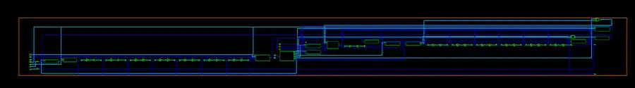

# Synthesis Results Summary

## Run configuration

| Parameter | Recorded value |
|---|---|
| Tool | Synopsys Design Compiler K-2015.06 |
| Top module | MIPI_Single_cyc_top |
| Elaborated memories | IMEM = 256 bytes; DMEM = 64 bytes |
| Clock constraint | 166.7 ns (approximately 6.0 MHz) |
| Compile setting | compile -map_effort medium |
| Target library | TSMC CL013G RVT SS, 1.08 V, 125 °C |

This is a pre-layout synthesis result for one stated configuration. The 166.7 ns period is the applied constraint, not a measured maximum operating frequency.

## Timing summary

| Metric | Result |
|---|---:|
| Critical path length | 133.02 ns |
| Worst setup slack | +0.040 ns |
| Total negative slack | 0.00 ns |
| Setup violating paths | 0 |
| Hold violations in QoR summary | 0 |
| Lowest slack among the displayed hold paths | +0.294 ns |

The worst setup path starts at u_pc/PC_out_reg_2_ and ends at ALUResult_out[31]. The path passes through instruction-memory read logic, register-file read logic, and the divider implementation inside the ALSU.

**Interpretation:** the design meets the supplied 166.7 ns constraint with only +0.040 ns of setup margin. This is a very small margin and is not evidence of a 50 MHz implementation or post-route timing closure.

## Area summary

| Metric | Result |
|---|---:|
| Total mapped cell area | 358,855.85 library area units |
| Combinational area | 239,692.62 library area units |
| Non-combinational area | 119,163.24 library area units |
| Buffer / inverter area | 16,729.14 library area units |
| Mapped cells in area report | 25,761 |
| Memory macros / black boxes | 0 |

### Largest hierarchical contributors

| Block | Cell area (library units) | Share of total |
|---|---:|---:|
| Instruction memory | 186,734.06 | 52.0% |
| ALSU | 65,854.02 | 18.4% |
| Data memory | 51,764.21 | 14.4% |
| Register file | 49,932.09 | 13.9% |
| PC calculation | 1,416.75 | 0.4% |
| PC register | 1,086.09 | 0.3% |
| Control unit | 271.82 | 0.1% |

The instruction and data memories together represent approximately 66.4% of mapped area. The synthesis report shows zero memory macros / black boxes, so the RTL byte arrays were mapped into standard-cell logic rather than SRAM macros.

Within the ALSU, the divider contributes 41,989.36 library area units (11.7% of total design area), while the multiplier contributes 17,323.38 (4.8%). Library area units are technology-library-dependent; they must not be interpreted as square micrometres without the library's area definition.

## Power estimate

| Metric | Result |
|---|---:|
| Cell internal power | 572.3166 µW |
| Net switching power | 20.0932 µW |
| Total dynamic power | 592.4099 µW |
| Cell leakage power | 245.2198 µW |
| **Total reported power** | **0.8376 mW** |

The report used low analysis effort and a vectorless activity estimate. It warns that primary inputs and sequential outputs are unannotated; no representative SAIF activity annotation is included. This is an estimate, not measured silicon power or workload-specific power.

## Design Vision schematic

The supplied screenshot is a zoomed-out schematic-window capture. It is not a physical layout, place-and-route result, or sign-off image.

## Scope and limitations

- Results are from synthesis only; no place-and-route, clock-tree synthesis, extracted-parasitic STA, DRC/LVS closure, GDSII generation, or silicon measurement is claimed.
- The power result is vectorless and lacks representative switching activity.
- The reported memories mapped to standard cells, not SRAM macros.
- Setup slack is positive but very small under the applied clock constraint.
