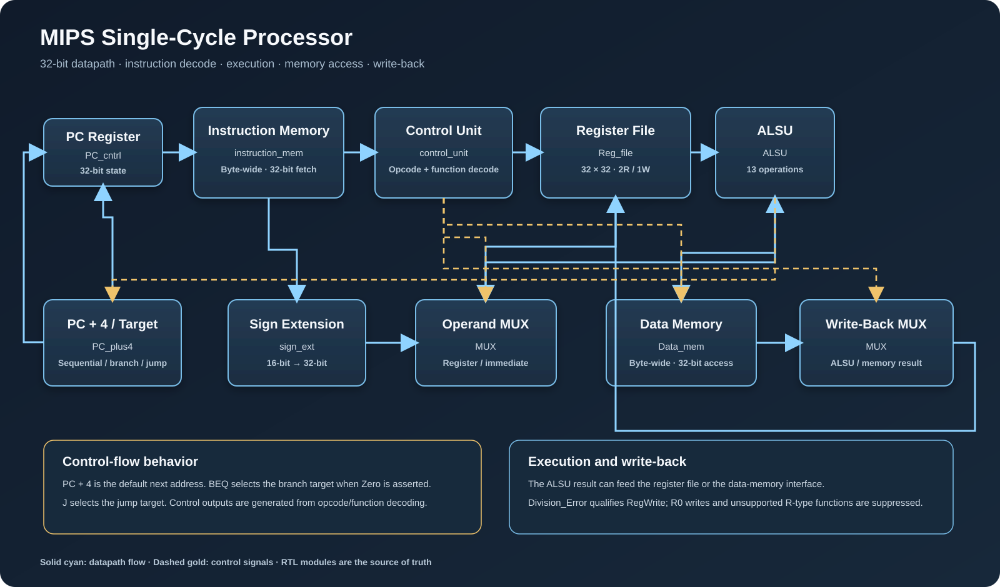

# Architecture assets

## RTL architecture overview

The vector figure above is the direct-view architecture illustration embedded in the root README as well. It shows the PC, instruction fetch, decode/control, register-file read, operand selection, ALSU, data memory, write-back, and PC target selection.

